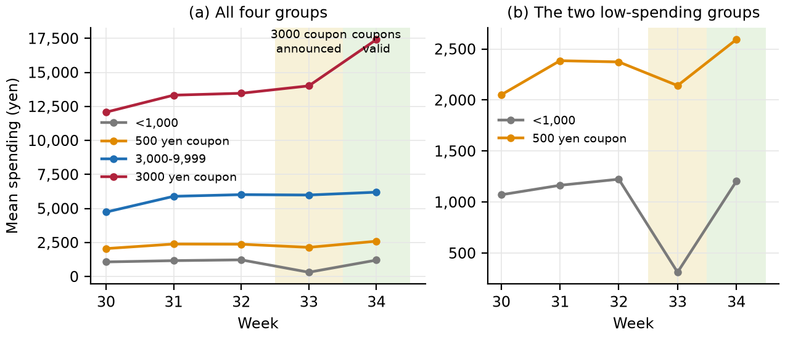
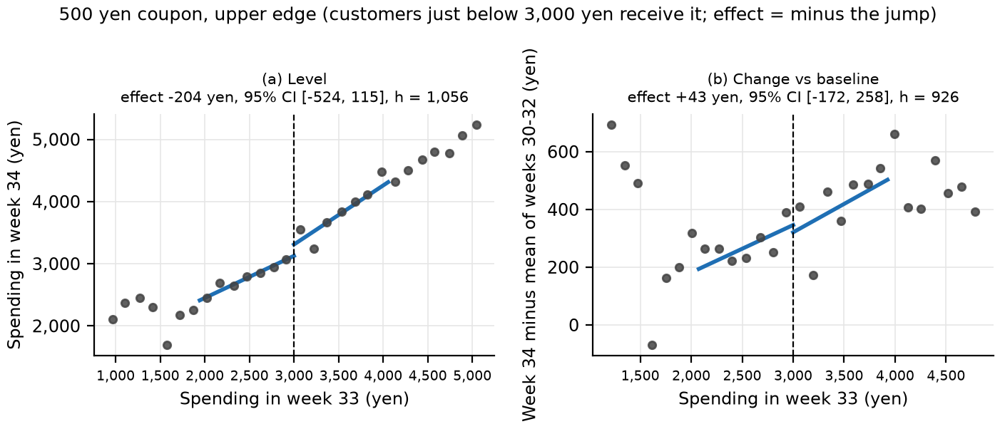
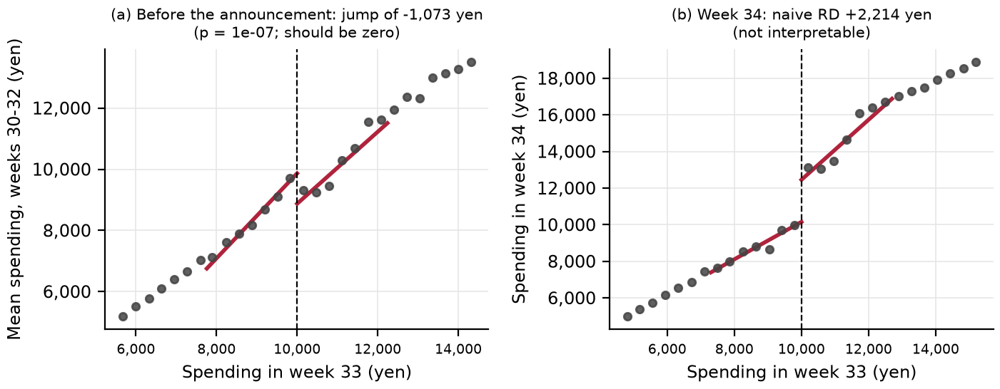
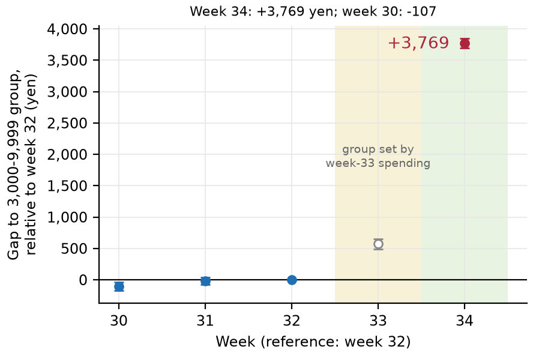
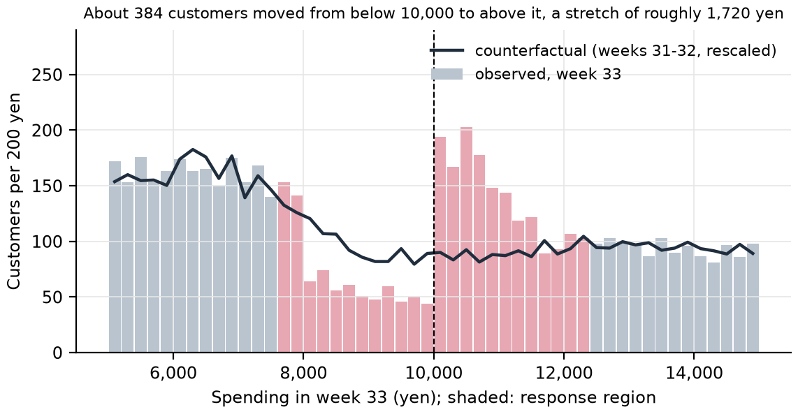
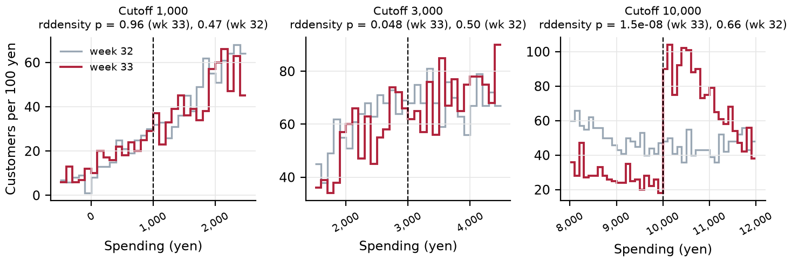
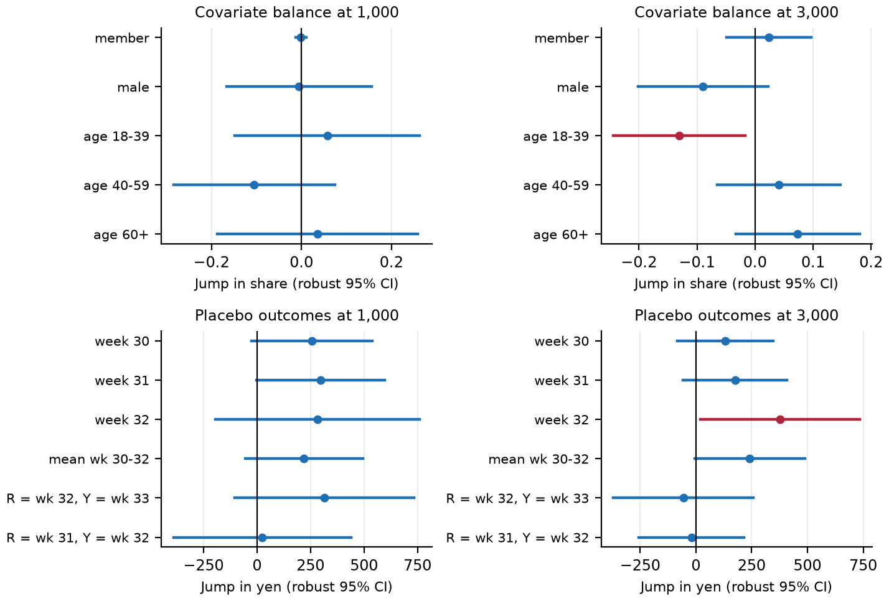
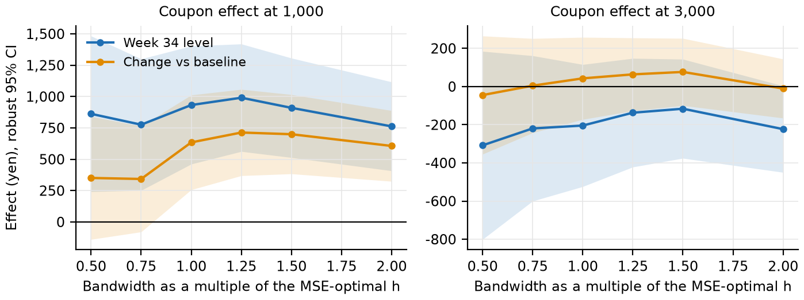

# Appendix: Reproducible Analysis of the Coupon Interventions

Simon Jensen · Student ID 2226237U · Topics in Econometrics B (Prof. Sawada) · Assignment 1
{: .byline }

This appendix belongs to the report `assignment_2226237U_simon_jensen.pdf`. The report stands on its own; this document is for the reader who wants to rerun or check the work. Part A is a user manual for the code. Part B explains how the code works. Parts C to G contain the full analysis with all figures and tables. Every number, table and figure below is generated by the pipeline from `results.json`; nothing is typed in by hand.

[TOC]

## A. User manual

### A.1 What the pipeline does

One command reads the customer panel, checks that it has the structure the analysis assumes, estimates every quantity in the report, draws the figures, and writes this appendix and the report as HTML and PDF. If the data are not as expected, the run stops before any estimate and says what is wrong and how to fix it.

### A.2 Requirements

- A terminal on macOS or Linux (Windows: use WSL, or set `COUPON_CHROME` for the PDFs).
- [uv](https://docs.astral.sh/uv/), the Python project manager. Install it once with `brew install uv` (macOS) or `curl -LsSf https://astral.sh/uv/install.sh | sh`. It installs the right Python (3.11 to 3.13) and all packages into a project-local folder, so no global Python package is touched.
- Google Chrome (or Chromium), only for the PDFs. The program looks at the macOS default path and then for `google-chrome` or `chromium` on the PATH. On Linux or Windows, or if Chrome sits elsewhere, set the environment variable `COUPON_CHROME` to the binary; without Chrome, use `--no-pdf`.
- An internet connection for the first `uv sync`. After that the pipeline runs offline.
- The data file `assignment_data_panel_obs.csv` in the project folder (it is part of the submission folder).

The versions used for the numbers in this document are Python 3.13.0, pandas 3.0.6, numpy 2.5.3, statsmodels 0.15.0, rdrobust 2.1.0, rddensity 3.0 and matplotlib 3.11.2. They are pinned in `uv.lock`.

### A.3 Install (once)

```bash
cd path/to/01-coupon-impact      # the folder that contains pyproject.toml
uv sync                          # needs internet; creates .venv and installs the pinned packages
```

### A.4 Run

```bash
uv run python -m coupon_analysis
```

The full run takes about one minute (the PDFs take most of it) and prints six numbered steps. It can be repeated at any time; it produces the same numbers each time.

`text.md`, the source of the report, is edited by hand. The pipeline therefore never overwrites it (only `--regen-report` does) and instead checks it: every estimate quoted in `text.md` must appear in `results.json`, allowing for rounding. If the data or the analysis change and a number in the text is out of date, the run prints each stale number with its line number and context and ends with exit code 3. The guard has blind spots: it ignores whole numbers below 100 (week numbers, counts such as 2 of 11), years, a short list of design constants (500, 1,000, 3,000, 10,000 and similar), and anything after the heading `## References`; a stale value that happens to equal such a constant is not caught. It checks that a number exists somewhere in `results.json`, not that it belongs to the right quantity.

Exit codes: **0** everything done and checked; **1** `--check` found errors in the data; **2** an error stopped the run (data contract, missing file, Chrome); **3** the run finished, but `text.md` quotes a stale number or the report has more than three pages. With `--no-pdf` no PDF is printed, so the page check is skipped.

**Table A1.** Command-line options.
{: .tcap }

| Option | Effect |
| :--- | :--- |
| (none) | Everything: validate, estimate, draw, write results.json and appendix.md, render appendix and report to HTML and PDF. |
| `--check` | Only validate the data file and print errors, warnings and notes. Writes nothing. Exit code 1 if the data break the contract. |
| `--no-pdf` | Write results, figures, appendix.md and appendix.html but skip the PDFs (no Chrome needed; the page check of the report is skipped too). |
| `--no-render` | Write results.json, figures and appendix.md only. |
| `--regen-report` | Rebuild text.md from its template. Without it, an existing text.md is never overwritten, because it is the file that gets edited by hand. |
| `--only figures` | Redraw the figures from the existing `results.json` and the data. |
| `--only report` | Render only `assignment_2226237U_simon_jensen.pdf` from the current `text.md` (fast; use after editing the text). Needs an existing `results.json`. |
| `--data PATH` | Read another CSV with the same columns (for example a corrected export). |
| `--root DIR` | Write all outputs into DIR instead of the project folder. |
| `-q` | Quiet: print only warnings and errors. |

### A.5 What is where

```text
01-coupon-impact/
├── pyproject.toml            project definition and dependencies
├── uv.lock                   exact versions of every package
├── assignment_data_panel_obs.csv    the data (input)
├── src/coupon_analysis/
│   ├── config.py             every design choice in one place (cutoffs, bandwidth rule, seeds, paths)
│   ├── data.py               load, validate, reshape to one row per customer
│   ├── descriptives.py       group means and the naive comparisons
│   ├── rdd.py                regression discontinuity: estimates, density tests, balance, placebo, bandwidths, robustness, donut
│   ├── multitest.py          Holm correction for the balance and placebo tests
│   ├── did.py                difference-in-differences, Card-Krueger 2x2 table, event study, placebo DiD
│   ├── bunching.py           effect of the announcement on week-33 spending
│   ├── costbenefit.py        coupon cost against incremental spending, break-even margin
│   ├── plots.py              figures
│   ├── results.py            runs everything, writes results.json
│   ├── tables.py, doc.py     fill the templates with numbers from results.json
│   ├── render.py             Markdown to HTML to PDF
│   ├── pipeline.py, __main__.py   the run and the command line
│   └── templates/            appendix and report templates
├── tests/                    pytest tests
├── results.json              generated: all numbers
├── figures/                  generated: PNG figures
├── appendix.md/.html/.pdf    generated: this document
├── text.md                   report source (edited by hand)
└── assignment_2226237U_simon_jensen.pdf    generated: the report
```

### A.6 Outputs

**Table A2.** Files the pipeline writes.
{: .tcap }

| File | What it contains |
| :--- | :--- |
| `results.json` | Every estimate, standard error, p-value and table entry. The single source of every number below and in the report. |
| `figures/*.png` | All figures, 200 dpi. |
| `appendix.md` | This document as Markdown, filled from `results.json`. |
| `appendix.html` | This document as one self-contained HTML file (figures embedded). |
| `appendix_2226237U_simon_jensen.pdf` | This document as a PDF. |
| `text.md` | Source of the report. Created from its template on the first run; edited by hand afterwards. |
| `assignment_2226237U_simon_jensen.pdf` | The report, at most three pages. |
| `build/` | Intermediate HTML of the report. Can be deleted. |

### A.7 What the program checks in the data

**Table A3.** Data contract checked before any estimate.
{: .tcap }

| Check | What must hold | If violated |
| :--- | :--- | :--- |
| Columns and types | All eleven columns exist; numeric columns are numbers; flags are 0/1; gender and age_category take only the documented values. | Error |
| Balanced panel | 10,000 ids (1 to 10,000), weeks 30 to 34, one row per id and week, 50,000 rows. | Error |
| Missing values | Only amount_spent_last_week_yen in week 30 is missing, and all of it is. | Error |
| Lag column | amount_spent_last_week_yen equals amount_spent_yen of the previous week for every customer. | Error |
| Constant per customer | is_member, gender, age_category and the four group flags do not change across weeks. | Error |
| One group per customer | Exactly one of the four group flags is 1. | Error |
| Flags against the written rule | A flag must agree with week-33 spending: below 1,000; 1,000 to 2,999; 3,000 to 9,999; 10,000 or more. Up to five disagreements are reported, more than five stop the run. | Warning, then error |
| Negative spending | Returns appear as negative amounts. They are counted and kept. | Note |

On the data supplied, the warnings are: Customer id 1387 is flagged 'is_eligible_1000' but spent 3,000 yen in week 33, which the written rule assigns to another group. The analysis keeps the data flag for descriptives and uses the written rule (week-33 spending) for the regression discontinuity designs. Notes: 200 customer-weeks have negative spending (returns); kept as they are.

### A.8 Common errors and fixes

**Table A4.** Error messages, causes and fixes.
{: .tcap }

| Message | Cause | Fix |
| :--- | :--- | :--- |
| `FileNotFoundError: Data file not found` | The CSV is not next to `pyproject.toml`. | Copy `assignment_data_panel_obs.csv` there, or pass `--data PATH`. |
| `The input data violate the contract (n problem(s))` | The file differs from the documented panel; the message lists every problem with the first id and week. | Fix the listed items; run `--check` to test without running the analysis. |
| `Google Chrome not found` | Chrome is not at the default macOS path or on the PATH. | Set `COUPON_CHROME` to the browser binary, or use `--no-pdf`. |
| `Could not find a version that satisfies the requirement` | uv cannot reach the package index. | Check the network and run `uv sync` again; the versions are fixed in `uv.lock`. |
| `ModuleNotFoundError: coupon_analysis` | The command was run outside the project folder or without `uv run`. | `cd` into the folder with `pyproject.toml` and use `uv run python -m coupon_analysis`. |
| `results.json not found` with `--only` | The full pipeline has not run yet. | Run `uv run python -m coupon_analysis` once. |
| `text.md line n: x is not in results.json` (exit code 3) | A number in the hand-edited text is stale or mistyped. | Edit the number in `text.md`, or run `--regen-report` (discards manual edits). |
| Report has more than three pages (warning, exit code 3) | `text.md` was edited and became longer. | Shorten the text; the page count is printed after every run. |
| `Unknown results path` while filling a template | A placeholder in a template names a key that is not in `results.json`. | Open `results.json`, find the right key, fix the template. |

### A.9 Tests

```bash
uv run pytest        # about 30 seconds
```

The tests in `tests/` check that the validation stops on broken data (missing column, duplicated rows, a changed lag column, a group flag that contradicts the rule), that the group flag that contradicts the rule is a warning and not a crash, that the key estimates are reproducible, that the estimators recover known effects in simulated data, that the break-even arithmetic is right, that the stale-number guard catches a changed figure in `text.md` (and that a run then exits with code 3), that the bunching estimator finds a known number of moved customers, that Holm's adjustment returns the values of a worked example, that the difference-in-differences estimate computed from the four cell means of the 2x2 table equals the regression coefficient α, that the robustness table has the expected rows, and that a full run writes every expected file.

### A.10 Reproducibility

All steps are deterministic. The only random step is the bootstrap for the bunching estimate, with a fixed seed (20261102) and 10,000 customers resampled 500 times. Packages are pinned in `uv.lock`. Running the command twice gives an identical `results.json`. Messages printed by `rdrobust` and `rddensity` are collected in `results.json` under `meta.estimator_messages`; in this run: Mass points detected in the running variable. (x86).

## B. How the pipeline works

### B.1 Data flow

```text
assignment_data_panel_obs.csv
        |  data.load_raw -> data.validate           stop on errors, collect warnings
        v
customer table (one row per customer: s30..s34, pre, d34_pre, covariates, group)
        |
        +-- descriptives.run     group means, naive differences
        +-- rdd.run              RD at 1,000 and 3,000 (valid), at 10,000 (invalid), density, balance and placebo with Holm correction,
        |                        bandwidth and kernel robustness, donut
        +-- did.run              Card-Krueger 2x2 table, DiD, event study, placebo DiD, robustness
        +-- bunching.run         announcement effect in week 33
        +-- costbenefit.run      cost and break-even margin
        v
results.json  ---->  figures/*.png  ---->  templates  ---->  appendix.md / text.md  ---->  HTML  ---->  PDF
```

The design choice behind this layout: estimation code never formats text, and the documents never contain a number that is not looked up in `results.json`. A figure or a sentence can therefore not drift away from the analysis.

### B.2 `data.py`: load, validate, reshape

`validate()` collects every problem before it raises, so one run lists everything that is wrong. `require_valid()` turns the list into one exception with a numbered message. `build_customers()` creates the table all other modules use: one row per customer, spending in each week (`s30` to `s34`), the baseline `pre` (mean of weeks 30 to 32, before the announcement), the outcome `d34_pre` (week 34 minus baseline), the covariates and the group label.

```python
def build_customers(df: pd.DataFrame) -> pd.DataFrame:
    """One row per customer: weekly spending s30..s34, baseline, outcomes, covariates and group label."""
    wide = df.pivot(index="id", columns="weeknum", values="amount_spent_yen").astype(float)
    wide.columns = [f"s{c}" for c in wide.columns]
    one = df[df.weeknum == C.OUTCOME_WEEK].set_index("id")
    cust = wide.copy()
    cust["pre"] = wide[[f"s{w}" for w in C.PRE_WEEKS]].mean(axis=1)    # baseline before the announcement
    cust["d34_pre"] = cust["s34"] - cust["pre"]
    cust["is_member"] = one.is_member.astype(float)
    cust["male"] = (one.gender == "male").astype(float)
    cust["age_18_39"] = (one.age_category == "18-39").astype(float)
    cust["age_40_59"] = (one.age_category == "40-59").astype(float)
    cust["age_60p"] = (one.age_category == "60+").astype(float)
    grp = pd.Series(index=cust.index, dtype=object)
    for flag, label in C.GROUPS.items():
        grp[one[flag] == 1] = label
    cust["group"] = pd.Categorical(grp, categories=C.GROUP_ORDER, ordered=True)
    cust["coupon_500"] = (one.is_eligible_1000 == 1).astype(int)
    cust["coupon_3000"] = (one.is_eligible_10000 == 1).astype(int)
    return cust
```

The group label comes from the data's own flags. The regression discontinuity designs do not use the flags but the written rule on week-33 spending, which is the running variable. The two agree for all but one customer (A.7).

### B.3 `descriptives.py`

Produces Table A5 and Table A6: mean spending by group and week, and the mean differences in week 34 that a summary table invites, next to the same difference in the baseline weeks.

### B.4 `rdd.py`

Notation follows the Lecture 4 slides (Regression Discontinuity and Related Designs, file 05-regression-discontinuity.pdf). The running variable is spending in week 33, R; the cutoff is c; the sharp design has D = 1{R ≥ c}. The estimate is the jump of the conditional mean at c, computed by local linear regression with a triangular kernel and the MSE-optimal bandwidth, with bias correction and robust confidence intervals (`rdrobust`). At the 3,000 yen edge the coupon sits on the left of the cutoff, so the coupon effect is the jump times minus one (`sign=-1`).

```python
def run_rd(y, r, c: float, sign: int = 1, h: float | None = None, b: float | None = None, **override) -> dict:
    """One RD estimate. Returns the bias-corrected effect with the robust 95% CI.
    `override` may change kernel, p or bwselect (robustness rows); everything else is fixed in config.py."""
    bad = set(override) - set(C.RD_OVERRIDABLE)
    if bad:
        raise ValueError(f"run_rd cannot override {sorted(bad)}. Fix: only {list(C.RD_OVERRIDABLE)} may differ from config.py.")
    y = np.asarray(y, dtype=float)
    r = np.asarray(r, dtype=float)
    kw = dict(c=c, p=C.RD_P, kernel=C.RD_KERNEL, bwselect=C.RD_BWSELECT, vce=C.RD_VCE)
    kw.update(override)
    if h is not None:
        kw.update(h=h, b=b if b is not None else h)
    o = _quiet(rdrobust, y, r, **kw)
    coef, se, ci, pv = o.coef.iloc[:, 0], o.se.iloc[:, 0], o.ci, o.pv.iloc[:, 0]
    lo, hi = float(ci.iloc[2, 0]), float(ci.iloc[2, 1])
    if sign < 0:
        lo, hi = -hi, -lo
    return {
        "effect": sign * float(coef.iloc[1]),          # bias-corrected
        "effect_conventional": sign * float(coef.iloc[0]),
        "se_robust": float(se.iloc[2]),
        "ci_lo": lo,
        "ci_hi": hi,
        "p": float(pv.iloc[2]),
        "h": float(o.bws.loc["h", "left"]),
        "h_right": float(o.bws.loc["h", "right"]),
        "b": float(o.bws.loc["b", "left"]),
        "n_left": int(o.N_h[0]),
        "n_right": int(o.N_h[1]),
    }
```

The density test (`rddensity`) is a wrapper in the same file. Balance, placebo, bandwidth sensitivity and donut checks call `run_rd` with other outcomes, other running variables, other bandwidths or a subsample.

Two further steps sit in the same file. `robustness()` re-estimates the headline effect with other bandwidth multiples, a uniform kernel, a quadratic fit (p = 2) and the `msetwo` and `cerrd` bandwidth selectors; the list of variants is `RD_ROBUSTNESS` in `config.py`, and the results are in Table A17. `multiple_testing()` collects the p-values of all balance and placebo tests at a cutoff and adjusts them with Holm's step-down method (Lecture 2 slides, deck 03; `multitest.holm_adjust`). A covariate with fewer than `MIN_RARE_OBS` observations of its rarer value inside the bandwidth is flagged, because its test cannot say much; it stays in the family, so the count of tests does not depend on the data.

```python
def holm_adjust(pvals: list[float]) -> list[float]:
    """Holm-adjusted p-values, in the order of the input."""
    p = list(pvals)
    for x in p:
        if x is None or not isinstance(x, (int, float)) or math.isnan(x) or not 0.0 <= x <= 1.0:
            raise ValueError(f"holm_adjust needs p-values between 0 and 1, got {x!r}. Fix: drop tests that were not run before adjusting.")
    m = len(p)
    order = sorted(range(m), key=lambda i: p[i])
    adj = [0.0] * m
    running = 0.0
    for rank, i in enumerate(order):
        running = max(running, min(1.0, (m - rank) * p[i]))
        adj[i] = running
    return adj
```

### B.5 `did.py`

The symbols T, G, D and α follow the Lecture 5 slides (Difference-in-Differences, file 08-difference-in-differences.pdf, slide 19). Y is spending, T = 1 in week 34 and 0 in the baseline weeks 30 to 32, G = 1 for customers with week-33 spending of 10,000 yen or more and 0 for 3,000 to 9,999 yen, D = T·G. The regression Y = β0 + β1 T + β2 G + α D + ε gives the DiD estimate α, the average effect on the treated (ATT) under parallel trends, with standard errors clustered by customer. Only this core follows the slides. The slides fix the groups in advance (New Jersey against Pennsylvania); here G is defined by spending in week 33, after the announcement (E.2). The event study, the placebo DiD, the trend adjustment, the bunching estimate and the donut regression discontinuity are not taught in Lecture 5, which states the parallel-trends assumption but gives no test for it; they are additional checks.

```python
def did_2x2(cust, treated, control, pre_weeks=C.PRE_WEEKS, post_week=C.OUTCOME_WEEK, covariates=False) -> dict:
    df = _long(cust, treated, control, pre_weeks, post_week)
    if covariates:
        for c in COV:                                    # centre at the treated mean: alpha stays the ATT
            df[c] = df[c] - df.loc[df.G == 1, c].mean()
        rhs = "T + G + D + " + " + ".join(COV) + " + " + " + ".join(f"{c}:T" for c in COV)
    else:
        rhs = "T + G + D"
    m = _fit(smf.ols(f"y ~ {rhs}", df), df["id"])
    means = df.groupby(["G", "T"]).y.mean()
    return _pack(m, extra={
        "n_treated": int(treated.sum()), "n_control": int(control.sum()),
        "mean_treated_pre": float(means[1, 0]), "mean_treated_post": float(means[1, 1]),
        "mean_control_pre": float(means[0, 0]), "mean_control_post": float(means[0, 1]),
    })
```

`card_krueger()` computes the four cell means directly from the data and from them the two naive comparisons, their biases and the difference-in-differences. The regression above is saturated (two dummies and their interaction), so both routes give the same α; a test checks this.

```python
def card_krueger(cust, treated, control, pre_weeks=C.PRE_WEEKS, post_week=C.OUTCOME_WEEK) -> dict:
    """The 2x2 table of Card and Krueger (Lecture 5, slides 8-17), computed from the raw cell means.

    Cells: mean spending of G = 1 and G = 0 in the baseline (T = 0) and in the post week (T = 1).
    Two naive comparisons and the bias each one contains:
      before-after for G = 1:   (treated post - treated pre)  = alpha + time change of the comparison group
      treated vs comparison after: (treated post - comparison post) = alpha + gap that existed before (selection term)
    alpha = difference of the two changes = the OLS coefficient on D in did_2x2 (the regression is saturated).
    """
    pre = cust[[f"s{w}" for w in pre_weeks]].mean(axis=1)
    post = cust[f"s{post_week}"]
    cell = {"treated_pre": float(pre[treated].mean()), "treated_post": float(post[treated].mean()),
            "control_pre": float(pre[control].mean()), "control_post": float(post[control].mean())}
    change_t = cell["treated_post"] - cell["treated_pre"]
    change_c = cell["control_post"] - cell["control_pre"]
    gap_pre = cell["treated_pre"] - cell["control_pre"]
    gap_post = cell["treated_post"] - cell["control_post"]
    did = change_t - change_c
    return {
        **cell,
        "change_treated": change_t, "change_control": change_c,
        "gap_pre": gap_pre, "gap_post": gap_post,
        "did": did,
        "naive_before_after": change_t, "bias_time": change_c,
        "naive_cross_section": gap_post, "bias_selection": gap_pre,
        "identity_before_after": change_t - (did + change_c),     # both identities hold exactly; stored so a test can see it
        "identity_cross_section": gap_post - (did + gap_pre),
    }
```

The event study subtracts each customer's week-32 spending from every other week and regresses the difference on group-by-week indicators. The coefficients for weeks 30 and 31 are the pre-trend test, the coefficient for week 34 is the effect relative to week 32.

```python
def event_study(cust, treated, control, ref_week: int = 32) -> dict:
    """Difference between the groups in week t, relative to the reference week (customer fixed effects)."""
    keep = treated | control
    base = cust.loc[keep]
    G = treated[keep].astype(int)
    weeks = [w for w in C.WEEKS if w != ref_week]
    rows = []
    for w in weeks:
        rows.append(pd.DataFrame({"d": base[f"s{w}"] - base[f"s{ref_week}"], "week": w, "G": G, "id": base.index}))
    df = pd.concat(rows)
    for w in weeks:
        df[f"t{w}"] = (df.week == w).astype(int)
        df[f"G{w}"] = df[f"t{w}"] * df.G
    rhs = " + ".join(f"t{w}" for w in weeks) + " + " + " + ".join(f"G{w}" for w in weeks)
    m = _fit(smf.ols(f"d ~ 0 + {rhs}", df), df["id"])
    coefs = {str(w): _pack(m, f"G{w}") for w in weeks}
    coefs[str(ref_week)] = {"estimate": 0.0, "se": 0.0, "ci_lo": 0.0, "ci_hi": 0.0, "p": 1.0}
    pre = [f"G{w}" for w in weeks if w < ref_week]
    wald = m.wald_test(", ".join(f"{p} = 0" for p in pre), scalar=True)
    return {"reference_week": ref_week, "coefficients": coefs,
            "pretrend_joint_p": float(wald.pvalue), "pretrend_weeks": [w for w in weeks if w < ref_week]}
```

### B.6 `bunching.py`

The announcement of the 3000 yen coupon at the start of week 33 gave customers a reason to spend more in order to reach 10,000 yen. Customers who did so leave a gap below the threshold and a surplus above it. The counterfactual histogram for week 33 is the average histogram of weeks 31 and 32, rescaled to the same count outside the response region. The week-33 effect of the announcement is the missing mass times the average stretch.

```python
def estimate(obs, ref_list, c: float = 10000, half_width: float = C.BUNCH_HALF_WIDTH) -> dict:
    """obs: week-33 spending; ref_list: spending in the reference weeks (same customers, same order)."""
    lo, hi = C.BUNCH_RANGE
    edges = np.arange(lo, hi + C.BUNCH_BIN, C.BUNCH_BIN)
    mids = edges[:-1] + C.BUNCH_BIN / 2
    observed = _counts(obs, edges)
    reference = np.mean([_counts(r, edges) for r in ref_list], axis=0)
    inside = (mids > c - half_width) & (mids < c + half_width)
    scale = observed[~inside].sum() / reference[~inside].sum()
    cf = reference * scale
    below, above = inside & (mids < c), inside & (mids > c)
    miss = np.clip(cf - observed, 0, None) * below
    exc = np.clip(observed - cf, 0, None) * above
    M, B = float(miss.sum()), float(exc.sum())
    origin, landing = float((mids * miss).sum() / M), float((mids * exc).sum() / B)
    return {"missing_mass": M, "excess_mass": B, "origin": origin, "landing": landing,
            "stretch": landing - origin, "stretch_min": c - origin,
            "effect_total": M * (landing - origin), "effect_total_min": M * (c - origin),
            "share_of_eligible": B / max(1.0, float((np.asarray(obs) >= c).sum())),
            "_plot": (mids, observed, cf, inside)}
```

### B.7 `costbenefit.py`

Revenue is not profit. The module reports incremental spending, the coupon cost at full redemption, and the break-even margin: the share of an extra yen of spending that would have to be margin for the coupon to pay for itself.

```python
def _row(label, n, face, effect_per_cust, extra_revenue=0.0, note=""):
    revenue = n * effect_per_cust + extra_revenue
    cost_full = n * face
    return {
        "label": label, "n_eligible": n, "face": face, "note": note,
        "effect_per_customer": effect_per_cust, "incremental_revenue": revenue,
        "cost_full_redemption": cost_full,
        "by_redemption": {str(int(round(r * 100))): {"cost": r * cost_full,
                                   "break_even_margin": (r * cost_full / revenue) if revenue > 0 else None}
                          for r in C.REDEMPTION_GRID},
    }
```

### B.8 `plots.py`, `results.py`, `render.py`

`plots.py` draws every figure from the results; the only estimation inside it is the local linear line drawn in the regression discontinuity plots, which repeats the estimator inside the bandwidth that `rdrobust` chose. `results.py` runs all modules and writes `results.json`. `tables.py` and `doc.py` build the tables and fill the templates. `render.py` converts Markdown to HTML (Python-Markdown with Pygments code highlighting), prints the HTML to PDF with headless Chrome and sets the PDF metadata.

## C. Descriptive statistics: what the Executive saw

The four groups are defined by spending in week 33, so they differ before any coupon exists. Table A5 shows this: the group that later receives the 3000 yen coupon spent 12,954 yen per week in weeks 30 to 32, the comparison group 5,547 yen.

**Table A5.** Mean spending by group (yen) and customer characteristics. Groups follow the data flags; the one customer at exactly 3,000 yen is counted with the 500 yen group, as flagged.
{: .tcap }

| Group (by week-33 spending) | Customers | Mean wk 30-32 | Week 33 | Week 34 | Member | Male | Age 18-39 |
| :--- | ---: | ---: | ---: | ---: | ---: | ---: | ---: |
| <1,000 | 267 | 1,153 | 312 | 1,203 | 0% | 92% | 42% |
| 500 yen coupon | 988 | 2,269 | 2,141 | 2,592 | 4% | 71% | 38% |
| 3,000-9,999 | 4,360 | 5,547 | 5,988 | 6,195 | 54% | 48% | 33% |
| 3000 yen coupon | 4,385 | 12,954 | 14,008 | 17,414 | 59% | 44% | 32% |

**Table A6.** Naive mean differences in week 34 and the share of each difference that was already there in the baseline weeks.
{: .tcap }

| Comparison | Difference in week 34 | Same difference, weeks 30-32 | Share already there before |
| :--- | ---: | ---: | ---: |
| 3000 coupon vs 3,000-9,999 | 11,218 | 7,408 | 66% |
| 500 coupon vs <1,000 | 1,389 | 1,116 | 80% |
| Any coupon vs no coupon | 8,781 | 5,697 | 65% |

A summary table would put the 3000 yen group 11,218 yen above the comparison group in week 34. 7,408 yen of that, 66%, was there before the coupon was announced. Over the 4,385 customers of the 3000 yen group the naive difference would suggest incremental spending of 49.2 million yen against a coupon cost of 13.2 million yen at full redemption, a factor of 2.9 more than the difference-in-differences estimate in Part E.



Figure A1 shows the second problem. The group below 1,000 yen is defined by a low week 33. Its mean falls from 1,153 yen in the baseline weeks to 312 yen in week 33 and returns to 1,203 yen in week 34 without any coupon. A before-and-after comparison for any group chosen on week 33 is therefore biased by mean reversion. Selection and mean reversion are the reasons a design is needed.

## D. Regression discontinuity: the 500 yen coupon

### D.1 Design

Customers with week-33 spending from 1,000 to 2,999 yen received a 500 yen coupon by e-mail. It was not announced, so customers could not move across the cutoffs on purpose; this is what makes the regression discontinuity design credible. The data show who was offered a coupon, not who redeemed it. D = 1{R ≥ c} is therefore eligibility, the design is sharp, and every regression discontinuity estimate below is an intention-to-treat (ITT) effect of being offered the coupon (Lecture 4 slide 15). A fuzzy design or an effect per redeemer would need redemption data, which the file does not contain. The estimand is the jump of expected week-34 spending Y at the cutoff c of the running variable R (spending in week 33), τ = lim<sub>r↓c</sub> E[Y | R = r] − lim<sub>r↑c</sub> E[Y | R = r]. The identifying assumption is continuity of E[Y(d) | R = r] at c, so that customers just on either side of the cutoff are comparable. The estimate is local: it describes customers near the cutoff only. Spending is recorded in whole yen, which creates repeated values of the running variable; `rdrobust` adjusts for these mass points, and there are many distinct values near each cutoff (the Lecture 4 slides (05-regression-discontinuity.pdf) warn about running variables with few distinct values).

Two outcomes are used. The level of week-34 spending is the direct outcome. The change from the baseline (week 34 minus the mean of weeks 30 to 32) removes customer-specific levels and is the more conservative one if the baseline is slightly higher just above the cutoff.

### D.2 Results

**Table A7.** Regression discontinuity estimates (rdrobust: local linear, triangular kernel, MSE-optimal bandwidth, bias-corrected estimate with robust confidence interval). The effect at 3,000 is the coupon effect, that is minus the jump. The estimates at 10,000 are shown only to document that the design fails there (Part E).
{: .tcap }

| Cutoff and outcome | Effect (yen) | Robust 95% CI | p | h (yen) | Effective n left / right |
| :--- | ---: | ---: | ---: | ---: | ---: |
| 1,000 (500 coupon above): week 34 | +932 | [461, 1,403] | <0.001 | 713 | 156 / 254 |
| 1,000: week 34 minus baseline | +634 | [257, 1,012] | <0.001 | 806 | 172 / 290 |
| 3,000 (500 coupon below): week 34 | −204 | [−524, 115] | 0.21 | 1,056 | 638 / 725 |
| 3,000: week 34 minus baseline | +43 | [−172, 258] | 0.70 | 926 | 566 / 630 |
| 10,000 (3000 coupon above): week 34, not valid | +2,214 | [1,817, 2,612] | <0.001 | 2,697 | 1068 / 1810 |
| 10,000: week 34 minus baseline, not valid | +3,553 | [3,208, 3,898] | <0.001 | 1,786 | 481 / 1360 |

At 1,000 yen the offer of the coupon raises week-34 spending by +932 yen (95% CI 461 to 1,403), or +634 yen relative to the baseline. Both point estimates exceed the 500 yen face value, and both intervals exclude zero. The change from baseline is the less stable of the two: it moves with the bandwidth and the polynomial order, and its interval includes zero in 3 of 10 variants (Table A17). At the upper edge, 3,000 yen, the effect is −204 yen (CI −524 to 115) in levels and +43 yen relative to baseline; the data cannot distinguish it from zero.




### D.3 What this does and does not show

The offer of the 500 yen coupon raises spending for customers just above 1,000 yen and shows no effect for customers just below 3,000 yen. The design identifies the effect at each cutoff and nowhere in between. Applying the effect at 1,000 yen to all 988 eligible customers is an upper bound; the evidence at 3,000 yen points the other way.

## E. Difference-in-differences: the 3000 yen coupon

### E.1 Why the regression discontinuity design fails at 10,000 yen

The 3000 yen coupon was announced at the start of week 33, and customers were told to spend 10,000 yen within the week. Customers close to the threshold had a reason to move across it. Figure A7 shows the result: the density of week-33 spending jumps at 10,000 (rddensity p-value <0.001), while the density of week 32 is smooth (p = 0.66). Figure A4 shows the consequence: customers just above 10,000 spent 1,073 yen less per week in the baseline weeks than customers just below, which a valid design would not produce (p <0.001). The baseline jump is the main reason continuity fails: a quantity that the coupon cannot have changed differs across the cutoff. The density test supports this, but it is neither necessary nor sufficient for a valid design (Lecture 4 slide 55), so it does not carry the conclusion alone. The regression discontinuity estimate of +2,214 yen therefore cannot be read as a coupon effect.



### E.2 Design

The comparison group is customers with 3,000 to 9,999 yen in week 33. They received no coupon and their week-33 spending lies below the manipulated region. The baseline is the mean of weeks 30 to 32, the weeks before the announcement. Identification rests on parallel trends: without the coupon, the gap between the groups would have stayed as it was in the baseline weeks.

This departs from the 2×2 set-up of Lecture 5, where the groups are fixed before the treatment (slide 19). Here G is defined by week-33 spending, which is measured after the announcement and is itself an outcome of it (E.4). The estimate α is therefore the average effect on the treated (ATT) for customers who spent 10,000 yen or more in week 33, including those the announcement pushed over the line.

The entry point is the Card-Krueger table of Lecture 5 (slides 8-17). Table A8 shows the four cell means with the notation of the slides. Table A9 lists the two naive comparisons and what each contains. The before-after change of the coupon group, +4,459 yen, includes the change of +649 yen that the comparison group showed without any coupon: a time effect. The comparison of the two groups after the coupon, +11,219 yen, includes the gap of +7,409 yen that existed before the coupon: the selection bias term E[Y(0) | G = 1] − E[Y(0) | G = 0] of the slides. The difference-in-differences removes both, α = 4,459 − 649 = +3,810 yen. It equals the regression coefficient in Table A8.

**Table A8.** Card-Krueger 2×2 table: mean weekly spending of the coupon group (G = 1) and the comparison group (G = 0), before (T = 0) and after (T = 1) the coupon. The last row is the gap between the groups; its last cell is α.
{: .tcap }

| Mean weekly spending (yen) | Before, T = 0 (mean wk 30-32) | After, T = 1 (week 34) | After minus before |
| :--- | ---: | ---: | ---: |
| Coupon group (G = 1) | 12,954 | 17,414 | +4,459 |
| Comparison group (G = 0) | 5,546 | 6,194 | +649 |
| Coupon minus comparison | +7,409 | +11,219 | **+3,810** = alpha (ATT), regression +3,810 [3,751, 3,870] |

**Table A9.** The two naive comparisons next to the difference-in-differences. The comparison after the coupon differs by about 1 yen from the 3000 yen figure in Part C, because Part C follows the data flag for the one customer at exactly 3,000 yen and this table follows the written rule.
{: .tcap }

| Comparison | Estimate (yen) | Estimate = alpha plus the | Bias (yen) | Term in Lecture 5 |
| :--- | ---: | :--- | ---: | :--- |
| Before-after, coupon group (T = 1 minus T = 0 for G = 1) | +4,459 | time change of the comparison group | +649 | time effect |
| Coupon group against comparison group after the coupon (G = 1 minus G = 0 at T = 1) | +11,219 | gap that existed before the coupon | +7,409 | selection bias term |
| Difference-in-differences alpha (ATT) | +3,810 | nothing: both biases drop out under parallel trends | 0 | none |

**Table A10.** Event study: gap between the 3000 yen group and the comparison group in each week, relative to week 32. Standard errors are clustered by customer.
{: .tcap }

| Week | Gap relative to week 32 (yen) | 95% CI | Note |
| :--- | ---: | ---: | ---: |
| 30 | −107 | [−173, −42] | before announcement |
| 31 | −17 | [−76, 42] | before announcement |
| 32 | 0 | - | reference |
| 33 | +571 | [487, 655] | group defined by this week (mechanical) |
| 34 | +3,769 | [3,691, 3,847] | coupon valid |
| Joint test, weeks 30 and 31 = 0 |  | p <0.001 |  |



The gap is 7,343 yen in week 30, 7,433 in week 31 and 7,450 in week 32, and 11,219 in week 34. The difference-in-differences estimate is +3,810 yen per customer (95% CI 3,751 to 3,870). The pre-trend coefficients are −107 yen in week 30 and −17 yen in week 31. The gap is therefore not flat: the joint test rejects zero (p <0.001), and the week-30 coefficient alone has p = 0.001. The deviation is small, though: 1.4% of the gap. Extending this trend to week 34 would lower the estimate to 3,662 yen, which bounds the possible bias from a linear trend.

### E.3 Robustness of the difference-in-differences estimate

**Table A11.** The 3000 yen coupon effect under alternative specifications.
{: .tcap }

| Specification | Estimate (yen) | 95% CI (cluster-robust) |
| :--- | ---: | ---: |
| Baseline: DiD, mean of weeks 30-32 (main) | +3,810 | [3,751, 3,870] |
| Baseline: week 32 only | +3,769 | [3,691, 3,847] |
| With covariates (member, gender, age; interacted with T) | +3,757 | [3,700, 3,814] |
| Linear pre-trend of the gap extended to week 34 | +3,662 | n/a |
| Proportional DiD (week 34 / own baseline - 1), in yen at the treated baseline | +2,984 | [2,889, 3,079] |
| Without everyone with 8,000-11,999 yen in week 33 (treated 12,000 or more; control 3,000-7,999) | +4,065 | [3,997, 4,132] |
| All treated, but only controls with 3,000-7,999 yen (none just below 10,000) | +3,811 | [3,751, 3,870] |
| Placebo DiD (groups by week 31, baseline week 30, outcome week 32) | +77 | [8, 146] |
| Main estimate minus placebo | +3,733 | n/a |

The estimate changes little across baseline choices, covariates and the trend adjustment. The placebo applies the same design one step back in time, when no coupon existed, and finds +77 yen (CI 8 to 146). That differs from zero at the 5% level, so some selection or mean reversion remains; it is 2.0% of the main estimate, and subtracting it gives 3,733 yen. The proportional version, which assumes that effects scale with a customer's own baseline, gives 2,984 yen; the size of the effect depends on this functional-form assumption, and Part G uses both.

The groups are defined by week-33 spending, the week the announcement moved. Two rows therefore remove the customers near 10,000: dropping everyone with 8,000 to 11,999 yen gives 4,065 yen (CI 3,997 to 4,132), and keeping all treated customers against controls with at most 7,999 yen gives 3,811 yen. Neither design can be fully clean. Customers may have pulled purchases forward from week 34 into week 33, which would lower the week-34 effect, and the comparison group may have been nudged by the announcement too. The data cannot measure either.

### E.4 The announcement effect in week 33

The effect of the 3000 yen coupon includes what the announcement did in week 33. Figure A6 compares the week-33 histogram with the counterfactual and finds a hole below 10,000 and a surplus above it. 384 customers moved from below 10,000 to above it, by about 1,720 yen each, which adds 660,409 yen to week-33 spending (95% CI 542,382 to 790,743). That is 151 yen per eligible customer, small next to the 3,000 yen coupon. The same procedure for week 32, when nothing was announced, finds a missing mass of 29.



**Table A12.** Bunching estimate of the announcement effect in week 33.
{: .tcap }

| Quantity | Estimate | 95% bootstrap CI / second value |
| :--- | ---: | ---: |
| Missing mass below 10,000 (customers) | 384 | [320, 445] |
| Excess mass above 10,000 (customers) | 592 |  |
| Mean origin of the missing mass (yen) | 8,956 |  |
| Mean landing point of the excess mass (yen) | 10,676 |  |
| Stretch (yen per customer) | 1,720 | [1,620, 1,869] |
| Week-33 spending added by the announcement (yen) | 660,409 | [542,382, 790,743] |
| Same, per eligible customer (yen) | 151 |  |
| Placebo (week 32 against weeks 30-31): missing mass | 29 |  |
| Sensitivity: response region +/- 2,000: missing mass / total yen | 393 | 661,691 |
| Sensitivity: response region +/- 2,500: missing mass / total yen | 384 | 660,409 |
| Sensitivity: response region +/- 3,000: missing mass / total yen | 382 | 683,976 |

### E.5 Donut regression discontinuity

As a second route around the manipulation, the customers within a few hundred yen of 10,000 are removed and the regression discontinuity design is estimated again on the rest.

**Table A13.** Regression discontinuity at 10,000 yen with a donut. The jump in the baseline measures how far the design is from valid.
{: .tcap }

| Donut (yen each side) | n | Jump in baseline | Change vs baseline | Robust 95% CI | Week 34 | Robust 95% CI |
| :--- | ---: | ---: | ---: | ---: | ---: | ---: |
| none | 10,000 | −1,073 | +3,553 | [3,208, 3,898] | +2,214 | [1,817, 2,612] |
| 200 | 9,762 | −1,447 | +3,093 | [2,682, 3,503] | +1,824 | [1,125, 2,522] |
| 400 | 9,545 | −1,522 | +2,652 | [2,053, 3,251] | +1,183 | [−96, 2,461] |
| 600 | 9,296 | −2,198 | +2,503 | [1,535, 3,472] | −1,086 | [−3,947, 1,776] |

The estimate for the change from baseline stays positive and clearly different from zero for every donut (3,093 to 2,503 yen) and is smaller than the difference-in-differences estimate. This is what proportional effects imply: the regression discontinuity estimate describes customers whose baseline is around 10,000 yen, the difference-in-differences estimate the whole group with a baseline of 12,954 yen. The level estimate for week 34 becomes imprecise as the donut grows and is not informative. Because the baseline still jumps at the cutoff (−2,198 yen at the widest donut), the donut regression discontinuity is a robustness check and the difference-in-differences estimate is the main result.

## F. Diagnostics

### F.1 Density of the running variable

**Table A14.** Density test of Cattaneo, Jansson and Ma (rddensity), jackknife variance. T is the test statistic, p its p-value; the null hypothesis is that the density is continuous at the cutoff.
{: .tcap }

| Cutoff | Week 32: T | Week 32: p | Week 33: T | Week 33: p |
| :--- | ---: | ---: | ---: | ---: |
| 1,000 | −0.72 | 0.47 | −0.04 | 0.96 |
| 3,000 | 0.67 | 0.50 | −1.98 | 0.048 |
| 10,000 | 0.44 | 0.66 | 5.66 | <0.001 |



There is no sign of manipulation at 1,000 yen (week 33: p = 0.96). At 3,000 yen the week-33 test gives p = 0.048, just below the 5% line, while week 32 gives 0.50. The 500 yen coupon was not announced, and one borderline result among 6 density tests is not unusual. It is reported, and it is separate from the balance and placebo tests of F.2. At 10,000 yen the test rejects clearly (p <0.001).

### F.2 Balance and placebo outcomes

If the design is valid, characteristics fixed before the coupon and spending in the baseline weeks should be continuous at the cutoff. Eleven tests per cutoff form one family (five covariates, four baseline outcomes, two lag placebos). With eleven independent tests at 5%, the chance of at least one rejection in a valid design is 43% (1 − 0.95^11), so the raw count says little. The Holm step-down correction (Lecture 2 slides, deck 03, slide 10) controls the chance of any false rejection in the family at 5%. Table A15 gives raw and adjusted p-values.

**Table A15.** Jumps at the two cutoffs in covariates and in outcomes the coupon cannot have changed (robust p-values), with Holm-adjusted p-values over the eleven tests of each cutoff. The lag placebos use spending in week 32 (or 31) as the running variable and the following week as the outcome. A dagger marks a test of a covariate that is almost constant inside the bandwidth: the member share at 1,000 yen has 6 members among the customers within the bandwidth, so the test is effectively uninformative.
{: .tcap }

| Variable | 1,000: jump | p | Holm p | 3,000: jump | p | Holm p |
| :--- | ---: | ---: | ---: | ---: | ---: | ---: |
| Member | −0.001 | 0.87 † | 1.00 † | +0.024 | 0.52 | 1.00 |
| Male | −0.005 | 0.95 | 1.00 | −0.089 | 0.12 | 0.96 |
| Age 18-39 | +0.058 | 0.58 | 1.00 | −0.131 | 0.024 | 0.26 |
| Age 40-59 | −0.105 | 0.25 | 1.00 | +0.041 | 0.45 | 1.00 |
| Age 60+ | +0.036 | 0.75 | 1.00 | +0.073 | 0.18 | 1.00 |
| Spending wk 30 | +256 | 0.075 | 0.75 | +132 | 0.23 | 1.00 |
| Spending wk 31 | +298 | 0.052 | 0.57 | +175 | 0.14 | 0.98 |
| Spending wk 32 | +283 | 0.24 | 1.00 | +378 | 0.038 | 0.38 |
| Mean wk 30-32 | +219 | 0.12 | 1.00 | +241 | 0.055 | 0.50 |
| Lag placebo (R wk 32, Y wk 33) | +315 | 0.14 | 1.00 | −57 | 0.72 | 1.00 |
| Lag placebo (R wk 31, Y wk 32) | +25 | 0.91 | 1.00 | −20 | 0.87 | 1.00 |
| Tests run | 11 |  |  | 11 |  |  |
| Rejected at 5% (raw p / after Holm) |  | 0 | 0 |  | 2 | 0 |
| Smallest p (raw / after Holm) |  | 0.052 | 0.57 |  | 0.024 | 0.26 |



At 1,000 yen, 0 of 11 tests reject at 5% before and 0 after the Holm correction (smallest raw p = 0.052, smallest adjusted p = 0.57). The member test cannot reject anything, so the family effectively has 10 informative tests; leaving it out changes the smallest adjusted p to 0.52. The baseline weeks lie 219 yen higher just above the cutoff, not significant, but too large to ignore; this is why the change-from-baseline outcome is reported next to the level. At 3,000 yen, 2 of 11 tests reject at 5% (share aged 18-39, spending in week 32) and 0 after the correction (smallest adjusted p = 0.26). The age imbalance remains the smallest p of the family, so it deserves a look in the null result at 3,000 yen, but it does not survive the correction.

### F.3 Bandwidth sensitivity



**Table A16.** Bandwidth sensitivity, both outcomes at both cutoffs.
{: .tcap }

| Cutoff, outcome | Bandwidth | h (yen) | Effect (yen) | Robust 95% CI | p |
| :--- | ---: | ---: | ---: | ---: | ---: |
| 1,000, week 34 | 0.50 x h | 356 | +862 | [241, 1,483] | 0.006 |
| 1,000, week 34 | 0.75 x h | 535 | +776 | [251, 1,300] | 0.004 |
| 1,000, week 34 | 1.00 x h | 713 | +932 | [461, 1,403] | <0.001 |
| 1,000, week 34 | 1.25 x h | 891 | +991 | [562, 1,419] | <0.001 |
| 1,000, week 34 | 1.50 x h | 1,069 | +910 | [513, 1,307] | <0.001 |
| 1,000, week 34 | 2.00 x h | 1,425 | +762 | [408, 1,117] | <0.001 |
| 1,000, change vs baseline | 0.50 x h | 403 | +351 | [−139, 841] | 0.16 |
| 1,000, change vs baseline | 0.75 x h | 605 | +343 | [−79, 765] | 0.11 |
| 1,000, change vs baseline | 1.00 x h | 806 | +634 | [257, 1,012] | <0.001 |
| 1,000, change vs baseline | 1.25 x h | 1,008 | +713 | [369, 1,057] | <0.001 |
| 1,000, change vs baseline | 1.50 x h | 1,209 | +700 | [384, 1,016] | <0.001 |
| 1,000, change vs baseline | 2.00 x h | 1,612 | +606 | [324, 888] | <0.001 |
| 3,000, week 34 | 0.50 x h | 528 | −308 | [−801, 185] | 0.22 |
| 3,000, week 34 | 0.75 x h | 792 | −219 | [−600, 162] | 0.26 |
| 3,000, week 34 | 1.00 x h | 1,056 | −204 | [−524, 115] | 0.21 |
| 3,000, week 34 | 1.25 x h | 1,321 | −137 | [−422, 148] | 0.35 |
| 3,000, week 34 | 1.50 x h | 1,585 | −116 | [−376, 143] | 0.38 |
| 3,000, week 34 | 2.00 x h | 2,113 | −223 | [−450, 4] | 0.054 |
| 3,000, change vs baseline | 0.50 x h | 463 | −45 | [−354, 265] | 0.78 |
| 3,000, change vs baseline | 0.75 x h | 694 | +5 | [−242, 252] | 0.97 |
| 3,000, change vs baseline | 1.00 x h | 926 | +43 | [−172, 258] | 0.70 |
| 3,000, change vs baseline | 1.25 x h | 1,157 | +64 | [−127, 255] | 0.51 |
| 3,000, change vs baseline | 1.50 x h | 1,388 | +77 | [−99, 253] | 0.39 |
| 3,000, change vs baseline | 2.00 x h | 1,851 | −10 | [−165, 144] | 0.89 |

At 1,000 yen the week-34 level estimate stays between 762 and 991 yen across the 6 bandwidths, and its interval excludes zero in 6 of them. The change-from-baseline estimate lies between 343 and 713 yen, with an interval that excludes zero in 4 of 6; the narrowest bandwidths leave fewer customers and wider intervals. At 3,000 yen the level estimate stays between −308 and −116 yen and the interval excludes zero in 0 of 6.

**Table A17.** Headline regression discontinuity estimate under other choices (Lecture 4): bandwidth multiples, uniform instead of triangular kernel, local quadratic instead of local linear, and two other bandwidth selectors. Both outcomes, both valid cutoffs.
{: .tcap }

| Specification | Level: effect | Robust 95% CI | p | Change vs baseline: effect | Robust 95% CI | p |
| :--- | ---: | ---: | ---: | ---: | ---: | ---: |
| **1,000 yen edge** |  |  |  |  |  |  |
| reference: triangular, p = 1, mserd | +932 | [461, 1,403] | <0.001 | +634 | [257, 1,012] | <0.001 |
| 0.50 x h (triangular, p = 1) | +862 | [241, 1,483] | 0.006 | +351 | [−139, 841] | 0.16 |
| 0.75 x h (triangular, p = 1) | +776 | [251, 1,300] | 0.004 | +343 | [−79, 765] | 0.11 |
| 1.25 x h (triangular, p = 1) | +991 | [562, 1,419] | <0.001 | +713 | [369, 1,057] | <0.001 |
| 1.50 x h (triangular, p = 1) | +910 | [513, 1,307] | <0.001 | +700 | [384, 1,016] | <0.001 |
| 2.00 x h (triangular, p = 1) | +762 | [408, 1,117] | <0.001 | +606 | [324, 888] | <0.001 |
| uniform kernel | +872 | [374, 1,369] | <0.001 | +633 | [231, 1,034] | 0.002 |
| local quadratic (p = 2) | +816 | [257, 1,374] | 0.004 | +230 | [−230, 690] | 0.33 |
| MSE-optimal, separate bandwidth per side (msetwo) | +568 | [188, 948] | 0.003 | +418 | [96, 741] | 0.011 |
| coverage-error-optimal bandwidth (cerrd) | +841 | [324, 1,359] | 0.001 | +418 | [12, 824] | 0.043 |
| **3,000 yen edge** |  |  |  |  |  |  |
| reference: triangular, p = 1, mserd | −204 | [−524, 115] | 0.21 | +43 | [−172, 258] | 0.70 |
| 0.50 x h (triangular, p = 1) | −308 | [−801, 185] | 0.22 | −45 | [−354, 265] | 0.78 |
| 0.75 x h (triangular, p = 1) | −219 | [−600, 162] | 0.26 | +5 | [−242, 252] | 0.97 |
| 1.25 x h (triangular, p = 1) | −137 | [−422, 148] | 0.35 | +64 | [−127, 255] | 0.51 |
| 1.50 x h (triangular, p = 1) | −116 | [−376, 143] | 0.38 | +77 | [−99, 253] | 0.39 |
| 2.00 x h (triangular, p = 1) | −223 | [−450, 4] | 0.054 | −10 | [−165, 144] | 0.89 |
| uniform kernel | −198 | [−517, 121] | 0.22 | +23 | [−214, 260] | 0.85 |
| local quadratic (p = 2) | −203 | [−555, 149] | 0.26 | +38 | [−188, 264] | 0.74 |
| MSE-optimal, separate bandwidth per side (msetwo) | −223 | [−504, 58] | 0.12 | +10 | [−187, 206] | 0.92 |
| coverage-error-optimal bandwidth (cerrd) | −226 | [−595, 144] | 0.23 | +13 | [−228, 253] | 0.92 |

At 1,000 yen the level estimate stays positive in all 10 variants, between 568 and 991 yen, and its interval excludes zero in 10 of them. The change-from-baseline estimate, the headline figure of the report, is positive in all variants too, but ranges from 230 to 713 yen and its interval excludes zero in 7 of 10. It includes zero at half the bandwidth (p = 0.16), at three quarters of it (p = 0.11) and with a local quadratic fit (p = 0.33). The change from baseline subtracts a noisy three-week mean from week 34, which widens the interval, and the narrow windows hold few customers. At 3,000 yen no variant finds an effect.

### F.4 Diagnostics of the difference-in-differences design

Parallel trends cannot be tested after the treatment; the checks above are the usual indirect evidence: the pre-trend coefficients of the event study (−107 and −17 yen: small, but the joint test rejects zero), the placebo DiD (+77 yen), the trend-adjusted estimate and the proportional specification. The week-33 coefficient is not a diagnostic: customers are sorted into groups by their spending in that week, so a gap there is mechanical.

### F.5 Limits

- **Local effects.** Each regression discontinuity estimate holds for customers at its cutoff only.
- **Intention to treat.** The data show eligibility, not redemption. The regression discontinuity effects are ITT effects of being offered the coupon. The difference-in-differences coefficient α is the average effect on the treated group (ATT); since redemption is not observed, G = 1 means eligible, so α is also an effect of the offer.
- **Spending is not profit.** See Part G.
- **One flagged customer.** One customer with exactly 3,000 yen is flagged as eligible for the 500 yen coupon although the written rule excludes 3,000. The regression discontinuity estimates use the written rule; one customer cannot move them.
- **Selection on one week.** The groups are defined by one week of spending, after the announcement, which departs from the fixed groups of the 2×2 set-up in Lecture 5. The placebo and the pre-trend checks address this, and no check can remove it entirely.
- **Bundled treatment.** For the 3000 yen coupon the announcement (week 33) and the coupon (week 34) come together. α measures both. There is no staggered start, so the problems of two-way fixed effects with staggered timing (Lecture 5, slides 37-42) do not arise.
- **No randomisation.** All estimates rest on the assumptions stated in D.1 and E.2.

## G. Cost-benefit

A coupon pays for itself only if the margin on the extra spending covers the coupon cost. The data contain no margin and no redemption. So the table shows the cost under the stated assumption that every eligible customer redeems the full face value, and the break-even margin: coupon cost divided by incremental spending. For lower redemption rates, cost and break-even margin scale down by the same factor. Incremental spending for the 3000 yen coupon is the week-34 effect times the 4,385 eligible customers plus the week-33 announcement effect from E.4. For the 500 yen coupon it is the local effect at 1,000 yen applied to all 988 eligible customers, which is an upper bound.

**Table A18.** Coupon cost and incremental spending, in million yen, with the margin needed to break even. Spending, not profit.
{: .tcap }

| Scenario | Eligible | Effect per customer (yen) | Incremental spending (m yen) | Cost at full redemption (m yen) | Break-even margin, 100% redemption | 50% redemption | 25% redemption |
| :--- | ---: | ---: | ---: | ---: | ---: | ---: | ---: |
| 500 yen: RD at 1,000, week 34 level | 988 | 932 | 0.92 | 0.49 | 54% | 27% | 13% |
| 500 yen: RD at 1,000, change vs baseline | 988 | 634 | 0.63 | 0.49 | 79% | 39% | 20% |
| 500 yen: lower end of CI at 1,000 | 988 | 461 | 0.46 | 0.49 | 108% | 54% | 27% |
| 3000 yen: DiD in levels + week-33 effect | 4,385 | 3,810 | 17.37 | 13.15 | 76% | 38% | 19% |
| 3000 yen: DiD in proportions + week-33 effect | 4,385 | 2,984 | 13.74 | 13.15 | 96% | 48% | 24% |
| 3000 yen: lower end of DiD CI | 4,385 | 3,751 | 16.45 | 13.15 | 80% | 40% | 20% |

For the 3000 yen coupon, incremental spending is 17.4 million yen against a cost of 13.2 million yen at full redemption. A margin of 76% would be needed to break even, and 96% under the proportional estimate. The 500 yen coupon needs 54% to 79% at the lower edge and has no measurable effect at the upper edge. Whether a margin of that size, or a redemption rate low enough, applies is a question for the company's own figures; the table shows what has to be true.

## Declaration of tools

The code, this appendix and the first draft of the report were written with the help of Claude (Anthropic) under the author's instructions. The author reviewed the results and the text and is responsible for them.
