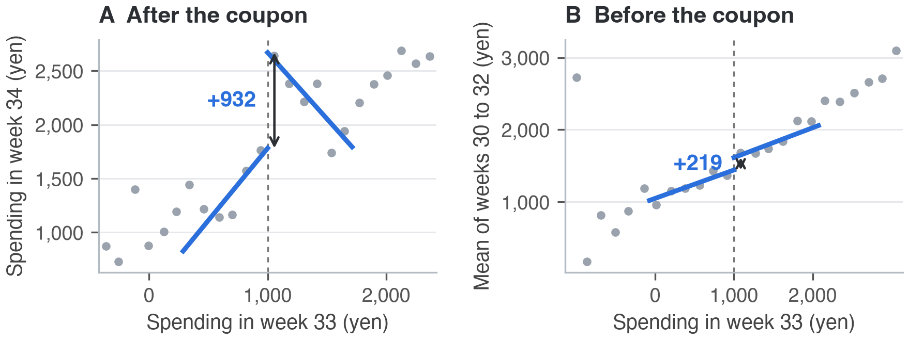

## Executive Summary

Should the company keep sending these coupons? Not in their current form. Neither coupon is shown to pay for itself. The 3000 yen coupon lifts spending by 3,810 yen per customer (95% CI 3,751 to 3,870), about its face value or more, yet covering its cost still takes a margin of 76% to 96%. The 500 yen coupon works only just above 1,000 yen, and even there its size depends on the specification.

The preliminary report puts the 3000 yen group 11,219 yen above the comparison group in week 34, and that figure is the problem: 66% of the gap existed before the announcement, because customers are grouped by week-33 spending. At face value it credits the coupon with 49.2 million yen of extra spending; the design-based figure is 17.4 million, against 13.2 million of coupon cost. A second trap: the group below 1,000 yen sees its mean fall to 312 yen in week 33 and recover to 1,203 by itself.

What does the design say instead? Customers just above 1,000 yen spent 634 yen more in week 34 than those just below, against their own weeks 30 to 32 (CI 257 to 1,012); in levels the gap is +932 yen (CI 461 to 1,403). We rely on the first, because the upper side already spent 219 to 298 yen more per week before any coupon; it is not significant (p = 0.052 to 0.24), yet the level estimate counts it as coupon effect. Near 3,000 yen it is −204 yen (CI −524 to 115), not different from zero.

**Recommendation.** At full redemption the 3000 yen coupon needs a margin of 76% to 96% and the 500 yen coupon 54% to 79% even if its effect held for every eligible customer. The ranges overlap, so the margin alone does not decide between them. We suggest (1) stopping the 3000 yen coupon as announced, which costs 13.2 million yen and bends behaviour, and (2) continuing the 500 yen coupon only as a controlled test with a randomised holdout that measures redemption and margin. At the lower end of its level interval it would need a margin of 108%, yet it costs only 0.49 million yen, so a test is cheap.

## Evidences

The 500 yen coupon is the cleaner experiment. It was sent without notice, so customers just below and above 1,000 yen differ only in the offer. That is a regression discontinuity (RD) design on week-33 spending. The data show the offer, not redemption, so RD estimates are intention-to-treat (ITT) effects. Let $X_i$ be spending in week 33, $Y_i$ spending in week 34, $c$ the cutoff and $D_i = \mathbf{1}\{X_i \ge c\}$ the offer. The estimand is

$$\tau_{\mathrm{RD}} = \lim_{x \downarrow c} \mathbb{E}[Y_i \mid X_i = x] - \lim_{x \uparrow c} \mathbb{E}[Y_i \mid X_i = x].$$

It is the ITT effect at the cutoff if $\mathbb{E}[Y_i(d) \mid X_i = x]$ is continuous in $x$ at $c$ for $d = 0, 1$. It is estimated by local linear regression with a triangular kernel $K$ and the MSE-optimal bandwidth $h$ (713 yen for the level and 806 for the change, at 1,000),

$$\min_{a,\,\tau,\,b_0,\,b_1} \sum_{i:\,|X_i - c| \le h} K\!\left(\tfrac{X_i - c}{h}\right) \bigl(Y_i - a - \tau D_i - b_0 (X_i - c) - b_1 D_i (X_i - c)\bigr)^2,$$

with bias-corrected point estimates and robust confidence intervals (Calonico et al., 2014). We use two outcomes: the level $Y_i$ and the change $\Delta Y_i = Y_i - \bar{Y}_i^{\,30\text{-}32}$ against each customer's own weeks 30 to 32.

In panel A, spending steps up by 932 yen where the coupon starts. Was that step already there? Panel B shows the same customers' spending in weeks 30 to 32, before any coupon, and the right side is already 219 yen higher. Against each customer's own weeks 30 to 32 the jump is 634 yen, the figure we rely on. At 3,000 yen the same design, with the coupon now below the cutoff, finds nothing.

The 3000 yen coupon was announced at the start of week 33, so customers could steer toward 10,000 yen and continuity fails there (Diagnostics). A different design fits: we compare the 4,385 customers with 10,000 yen or more in week 33 (G = 1) with the 3,000-9,999 group (G = 0), before and after the announcement (T = 0, 1), using weeks 30 to 32 as baseline (Sawada, 2026, Lecture 5). Unlike in the slides, our groups are defined by week-33 spending, measured after the announcement. The difference-in-differences (DiD) coefficient α is therefore the ATT of being eligible: an effect of the offer, including on customers the announcement pushed over the line. With $Y_{it}$ the spending of customer $i$ in period $t$,

$$Y_{it} = \beta_0 + \beta_1 T_t + \beta_2 G_i + \alpha D_{it} + \varepsilon_{it}, \quad D_{it} = G_i T_t, \quad \alpha = (\bar{Y}_{1,1} - \bar{Y}_{1,0}) - (\bar{Y}_{0,1} - \bar{Y}_{0,0}),$$

where $\bar{Y}_{g,t}$ is the mean of group $g$ in period $t$ and standard errors are clustered by customer. Parallel trends means $\mathbb{E}[Y_{i1}(0) - Y_{i0}(0) \mid G_i = 1] = \mathbb{E}[Y_{i1}(0) - Y_{i0}(0) \mid G_i = 0]$: without the coupon, both groups would have changed by the same amount.

In A the coupon group led in every earlier week, so the raw gap misleads. In B the gap barely moves in weeks 30 and 31 (−107 and −17 yen) and jumps to +3,769 in week 34. The four group means behind it form the two-by-two comparison of Card and Krueger (1994). The coupon group gained 4,459 yen, the comparison group 649. Looking only at the coupon group's change would credit the coupon with a time effect, and comparing the groups after the announcement would carry over the 7,409 yen gap that existed before, the selection term. The difference of the two changes removes both: $\alpha = 4,459 - 649 = 3,810$ yen.

The announcement also moved behaviour. Against the mean of weeks 31 and 32, about 384 customers who would have spent below 10,000 yen spent about 1,720 yen more and landed just above the line, worth 0.66 million yen in week 33.

Spending is not profit. A coupon of face value $f$ sent to $N$ customers, a share $r$ of whom redeem it, pays for itself only if $m\,\Delta R \ge r N f$ ($\Delta R$: extra spending, $m$: margin on it). The break-even margin is

$$m^{*} = \frac{r\,N f}{\Delta R}.$$

For the 3000 yen coupon at $r = 1$, $Nf = 4,385 \times 3{,}000 = 13.2$ million yen and $\Delta R = 17.4$ million (incl. the announcement effect), so $m^{*} = 76%$. Table 1 lists $m^{*}$; at 50% redemption it halves.

**Table 1.** Estimated coupon effects and the margin needed to break even at full redemption (the 3000 yen margins include the 0.66 million yen announcement effect).
{: .tcap }

| Coupon and estimate | Design | Effect, yen [95% CI] | Break-even margin |
| :--- | :--- | ---: | ---: |
| 500 yen at 1,000, vs baseline | RD | +634 [257, 1,012] | 79% |
| 500 yen at 1,000, level | RD | +932 [461, 1,403] | 54% |
| 500 yen at 3,000, level | RD | −204 [−524, 115] | no effect |
| 3000 yen, levels | DiD | +3,810 [3,751, 3,870] | 76% |
| 3000 yen, proportional | DiD | +2,984 [2,889, 3,079] | 96% |

## Diagnostics

At 1,000 yen the density test (Cattaneo et al., 2020) gives p = 0.96: no sign of manipulation. Of 11 balance and placebo tests, 0 reject after Holm's (1979) correction, which multiplies the $k$-th smallest of $m$ p-values by $m - k + 1$, keeps the order and caps at 1. Table 2 summarises all designs. The change from baseline is the less stable estimate: across 10 bandwidth, kernel and polynomial choices it runs from +230 to +713 yen, and its interval includes zero in 3. The level estimate never includes zero (+568 to +991 yen). At 3,000 yen the week-33 density test is borderline (p = 0.048; week 32: p = 0.50), and 2 of 11 balance and placebo tests reject at 5%, none after Holm's correction.

Continuity fails at 10,000 yen. Customers just above spent 1,073 yen less per week at baseline, which no coupon explains; the density test rejects too (p <0.001), though alone it would not decide the case (Sawada, 2026, Lecture 4). The naive estimate (+2,214 yen) is no coupon effect.

Parallel trends cannot be tested after treatment, so we test around it. In the event-study version,

$$Y_{it} = \lambda_i + \mu_t + \sum\nolimits_{k \ne 32} \gamma_k\, G_i\, \mathbf{1}\{t = k\} + \varepsilon_{it},$$

the pre-period coefficients $\gamma_{30}$ and $\gamma_{31}$ should be zero. The joint pre-trend test rejects (p <0.001): the gap was not constant before. The deviation is small (−107 yen in week 30, 1.4% of the gap), and extending the trend gives 3,662 instead of 3,810 yen. The same design one step back in time, with no coupon, gives +77 yen: not zero but only 2.0% of the main effect. If effects scale with baseline spending, that is, if growth $Y_{i1} / \bar{Y}_{i0} - 1$ is compared instead of the difference, the estimate is 2,984 yen.

**Table 2.** Validity checks by design.
{: .tcap }

| Design | Density p | Tests rejected, raw / Holm | Reading |
| :--- | ---: | ---: | :--- |
| RD at 1,000 | 0.96 | 0 of 11 / 0 | valid |
| RD at 3,000 | 0.048 | 2 of 11 / 0 | valid, density borderline |
| RD at 10,000 | <0.001 | n/a | invalid, baseline −1,073 yen |
| DiD, 3000 yen | n/a | n/a | pre-trend p <0.001, placebo +77 yen |

Two limits remain. Each RD estimate holds at its cutoff only, and the data show eligibility, not redemption. Purchases may have been pulled forward into week 33 and the announcement may have nudged the comparison group; we cannot measure either. Code and robustness checks: Jensen (2026); the course data must be added to reproduce them.

## References

Calonico, S., Cattaneo, M. D., & Titiunik, R. (2014). Robust nonparametric confidence intervals for regression-discontinuity designs. *Econometrica, 82*(6), 2295-2326. https://doi.org/10.3982/ECTA11757

Card, D., & Krueger, A. B. (1994). Minimum wages and employment: A case study of the fast-food industry in New Jersey and Pennsylvania. *American Economic Review, 84*(4), 772-793.

Cattaneo, M. D., Jansson, M., & Ma, X. (2020). Simple local polynomial density estimators. *Journal of the American Statistical Association, 115*(531), 1449-1455. https://doi.org/10.1080/01621459.2019.1635480

Holm, S. (1979). A simple sequentially rejective multiple test procedure. *Scandinavian Journal of Statistics, 6*(2), 65-70.

Jensen, S. (2026). *coupon-impact-analysis: Code and appendix for Assignment 1* [Computer software]. GitHub. https://github.com/sj-johnsen/coupon-impact-analysis

Sawada, M. (2026). *Topics in Econometrics B: Lectures 4 and 5* [Lecture slides]. Hitotsubashi University.
